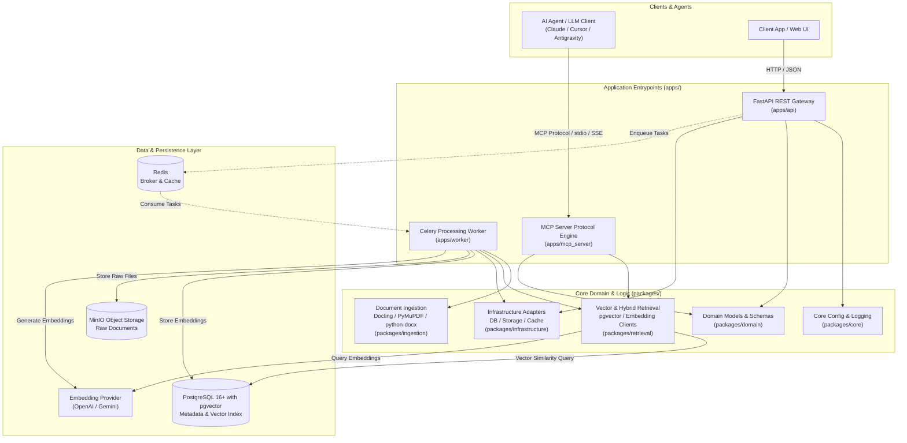

# MCP Knowledge Service

[](https://www.python.org/)
[](https://fastapi.tiangolo.com)
[](https://modelcontextprotocol.io/)
[](https://astral.sh/uv)
[](#architecture)
[](https://github.com/astral-sh/ruff)

An enterprise-grade, asynchronous Knowledge Management and Semantic Retrieval Service designed around the **Model Context Protocol (MCP)**. 

The service provides a unified ingestion and retrieval backbone that empowers AI agents, LLM applications, and developer tooling (such as Claude Desktop, Cursor, Antigravity, and custom agentic frameworks) to securely index, search, and ground contextual knowledge across heterogeneous document types.

---

## Table of Contents

- [Architectural Overview](#architectural-overview)
- [System Architecture Diagram](#system-architecture-diagram)
- [Key Features](#key-features)
- [Repository Layout](#repository-layout)
- [Technology Stack](#technology-stack)
- [Prerequisites](#prerequisites)
- [Quickstart Guide](#quickstart-guide)
  - [1. Environment Setup](#1-environment-setup)
  - [2. Dependency Installation](#2-dependency-installation)
  - [3. Infrastructure Services (Docker)](#3-infrastructure-services-docker)
  - [4. Database Migrations](#4-database-migrations)
  - [5. Running the Application Services](#5-running-the-application-services)
- [Configuration Reference](#configuration-reference)
- [API & MCP Interfaces](#api--mcp-interfaces)
  - [REST API Endpoints](#rest-api-endpoints)
  - [MCP Server Interface](#mcp-server-interface)
- [Testing & Quality Assurance](#testing--quality-assurance)
- [Development Conventions](#development-conventions)
- [Security & Compliance](#security--compliance)
- [License](#license)

---

## Architectural Overview

`mcp-knowledge-service` is organized as a clean **Modular Monorepo** adopting Hexagonal (Ports and Adapters) principles. The codebase strictly separates runnable application entry points (`apps/`) from reusable, business-driven packages (`packages/`):

1. **Decoupled Runtimes**: Distinct application processes for the public HTTP REST API (`apps/api`), the MCP Server protocol handler (`apps/mcp_server`), and asynchronous background workers (`apps/worker`).
2. **Domain-Centric Packages**: Domain logic, document ingestion engines, vector retrieval mechanics, and infrastructural clients are housed as independent, cohesive packages that can be composed across runtimes.
3. **Asynchronous Ingestion Pipeline**: Resource-heavy operations (OCR, PDF document structure parsing, semantic chunking, and embedding generation) are delegated to Celery workers via Redis, preventing API thread exhaustion and supporting horizontal scaling.
4. **Hybrid Persistence Layer**: 
   - **PostgreSQL + pgvector**: Stores document metadata, relational structures, and vector embeddings in a single ACID-compliant database.
   - **MinIO (S3-Compatible)**: Acts as an immutable object store for raw uploaded files and extracted artifacts.
   - **Redis**: Serves as the task queue broker and low-latency cache.

---

## System Architecture Diagram



---

## Key Features

- **Model Context Protocol (MCP) Native**: Direct integration with AI clients via MCP standard resources (documents, collections) and tools (semantic search, ingest).
- **High-Fidelity Document Ingestion**: Advanced layout parsing and text extraction leveraging `docling`, `pymupdf`, and `python-docx`.
- **Vector & Semantic Search**: Native vector search powered by `pgvector` with cosine similarity, L2 distance, and inner product indexing (HNSW / IVFFlat).
- **Object Storage Backed**: Full S3/MinIO lifecycle support for raw documents, metadata preservation, and content hashing.
- **Async Task Orchestration**: Resilient Celery task worker with automated retries via `tenacity`.
- **Observable by Design**: Structured JSON logging powered by `structlog` with correlation IDs and runtime diagnostics.
- **Fast Modern Tooling**: Built with `uv` for sub-second virtualenv resolution, deterministic lockfiles (`uv.lock`), and lightning-fast script execution.

---

## Repository Layout

```text
mcp-knowledge-service/
├── .env.example                  # Template configuration environment variables
├── .gitignore                    # Standard Python, IDE, and virtualenv exclusions
├── .python-version               # Fixed Python version pin (3.12)
├── pyproject.toml                # Build configuration, dependencies, and tool settings
├── uv.lock                       # Cryptographically hashed deterministic lockfile
├── README.md                     # Architecture documentation and service manual
│
├── apps/                         # Executable runtime targets
│   ├── api/                      # REST API application
│   │   ├── __init__.py
│   │   └── main.py               # FastAPI gateway entrypoint & health checks
│   ├── mcp_server/               # Model Context Protocol service
│   │   ├── __init__.py
│   │   ├── resources/            # MCP exposed data resources
│   │   └── tools/                # MCP callable tool definitions
│   └── worker/                   # Celery background workers
│       ├── __init__.py
│       └── tasks/                # Asynchronous document processing tasks
│
├── packages/                     # Shared domain and infrastructure packages
│   ├── core/                     # Fundamental settings and base utilities
│   │   ├── __init__.py
│   │   └── config.py             # Pydantic Settings implementation
│   ├── domain/                   # Business entities, domain events, value objects
│   ├── infrastructure/           # Database sessions, MinIO client, Redis connectors
│   ├── ingestion/                # Document parsers, splitters, chunking strategies
│   ├── observability/            # Logging formatters, tracing, metrics
│   └── retrieval/                # Vector search engines, ranking, embedding adapters
│
├── migrations/                   # Alembic schema migrations
├── scripts/                      # Operational, maintenance, and deployment scripts
├── src/                          # uv-build packaging namespace
│   └── mcp_knowledge_service/    # Distribution entrypoints
│
└── tests/                        # Comprehensive automated test suite
    ├── unit/                     # Fast isolated unit tests (config, schemas, parsers)
    ├── integration/              # Database and storage integration tests
    └── e2e/                      # End-to-end API and MCP protocol verification
```

---

## Technology Stack

| Layer | Component | Description |
| :--- | :--- | :--- |
| **Language & Runtime** | Python 3.12+ | Modern type hints, pattern matching, async IO |
| **Package Manager** | `uv` (Astral) | High-performance Python packaging and venv manager |
| **Web Gateway** | FastAPI & Uvicorn | High-throughput asynchronous ASGI web server |
| **Agent Protocol** | Model Context Protocol (`mcp[cli]`) | Anthropic standard for LLM knowledge grounding |
| **Vector Database** | PostgreSQL 16 + `pgvector` | Relational metadata + vector embedding index |
| **ORM / Data Access** | SQLAlchemy 2.0 + `asyncpg` | Asynchronous relational data mapper |
| **Migration Engine** | Alembic | Version-controlled schema migrations |
| **Distributed Queue** | Celery + Redis | Background async task dispatch & broker |
| **Object Storage** | MinIO | S3-compatible raw file storage |
| **Document Processing** | Docling, PyMuPDF, Python-Docx | Multi-format PDF, Markdown, and DOCX extractors |
| **Validation & Config** | Pydantic V2 & Pydantic-Settings | Strongly typed runtime data validation |
| **Observability** | Structlog | Contextual, structured JSON log streaming |
| **Testing & Quality** | Pytest, Pytest-Asyncio, Ruff, Mypy | Test runner, fast linter, static typing |

---

## Prerequisites

Ensure the following tools are installed on your host system:

- [Python 3.12+](https://www.python.org/downloads/)
- [`uv` Package Manager](https://docs.astral.sh/uv/getting-started/installation/)
- [Docker & Docker Compose](https://docs.docker.com/get-docker/) (for local Postgres, Redis, and MinIO)
- `git`

---

## Quickstart Guide

### 1. Environment Setup

Clone the repository and initialize your local `.env` file from the provided template:

```bash
cp .env.example .env
```

Review and adjust any parameters inside `.env` to suit your local setup (e.g., API keys, database credentials).

### 2. Dependency Installation

Install all project dependencies and virtual environments with `uv`:

```bash
# Sync all dependencies including dev toolchains
uv sync --all-groups
```

### 3. Infrastructure Services (Docker)

Spin up PostgreSQL with `pgvector`, Redis, and MinIO in your local development environment:

```bash
docker run -d --name mcp-postgres \
  -e POSTGRES_USER=knowledge \
  -e POSTGRES_PASSWORD=knowledge \
  -e POSTGRES_DB=knowledge \
  -p 5432:5432 \
  pgvector/pgvector:pg16

docker run -d --name mcp-redis \
  -p 6379:6379 \
  redis:7-alpine

docker run -d --name mcp-minio \
  -e MINIO_ROOT_USER=minioadmin \
  -e MINIO_ROOT_PASSWORD=change-this-secret \
  -p 9000:9000 \
  -p 9001:9001 \
  minio/minio server /data --console-address ":9001"
```

### 4. Database Migrations

Apply database schema migrations using Alembic:

```bash
uv run alembic upgrade head
```

### 5. Running the Application Services

#### A. Run the REST API Gateway
Start the FastAPI server with hot-reload enabled:

```bash
uv run uvicorn apps.api.main:app --reload --host 127.0.0.1 --port 8000
```
- Interactive Swagger UI: [http://127.0.0.1:8000/docs](http://127.0.0.1:8000/docs)
- Alternative ReDoc: [http://127.0.0.1:8000/redoc](http://127.0.0.1:8000/redoc)
- Health Check: [http://127.0.0.1:8000/health](http://127.0.0.1:8000/health)

#### B. Run the Celery Processing Worker
In a separate terminal, launch the background worker to process document queues:

```bash
uv run celery -A apps.worker.main worker --loglevel=info --concurrency=4
```

#### C. Run the MCP Server
To expose tools and resources to MCP-compatible AI hosts:

```bash
uv run python -m apps.mcp_server.main
```

---

## Configuration Reference

All settings are validated at startup via `pydantic-settings` in `packages/core/config.py`.

| Parameter | Type | Default | Description |
| :--- | :--- | :--- | :--- |
| `APP_NAME` | `string` | `"knowledge-mcp"` | Human-readable name of the service |
| `ENVIRONMENT` | `string` | `"development"` | Runtime stage (`development`, `staging`, `production`) |
| `LOG_LEVEL` | `string` | `"INFO"` | Logging threshold (`DEBUG`, `INFO`, `WARNING`, `ERROR`) |
| `DATABASE_URL` | `string` | *Required* | Async PostgreSQL connection string (`postgresql+asyncpg://...`) |
| `REDIS_URL` | `string` | *Required* | Redis connection string for Celery & cache (`redis://...`) |
| `MINIO_ENDPOINT` | `string` | `"minio:9000"` | Host and port for the S3/MinIO service |
| `MINIO_ACCESS_KEY` | `string` | *Required* | MinIO/S3 access key credential |
| `MINIO_SECRET_KEY` | `string` | *Required* | MinIO/S3 secret access key |
| `MINIO_BUCKET` | `string` | `"knowledge"` | Default target bucket for document artifacts |
| `EMBEDDING_PROVIDER` | `string` | `"openai"` | Provider for vector embeddings (`openai`, `gemini`, etc.) |
| `EMBEDDING_MODEL` | `string` | `"text-embedding-3-small"` | Target embedding model identifier |
| `EMBEDDING_DIMENSIONS` | `int` | `1536` | Dimensionality of generated vector embeddings |
| `API_KEY` | `string` | `""` | Optional shared bearer token for API authentication |

---

## API & MCP Interfaces

### REST API Endpoints

| Method | Route | Description |
| :--- | :--- | :--- |
| `GET` | `/` | Service identification and basic status |
| `GET` | `/health` | Liveness and readiness probe for container orchestrators |
| `GET` | `/docs` | OpenAPI / Swagger interactive documentation |
| `GET` | `/redoc` | OpenAPI / ReDoc documentation |

### MCP Server Interface

The MCP server connects directly to LLMs via standard standard input/output (stdio) or Server-Sent Events (SSE).

#### Example MCP Tools:
- **`search_knowledge(query, top_k, filter)`**: Performs vector similarity and hybrid keyword search over indexed documents.
- **`ingest_document(uri, metadata)`**: Submits a document URL or local URI to the ingestion queue.
- **`get_document_chunks(document_id)`**: Inspects extracted chunks and semantic partitions of a document.

#### Connecting to Claude Desktop / Cursor:
Add the following to your `claude_desktop_config.json`:

```json
{
  "mcpServers": {
    "knowledge-service": {
      "command": "uv",
      "args": [
        "--directory",
        "/path/to/mcp-knowledge-service",
        "run",
        "python",
        "-m",
        "apps.mcp_server.main"
      ]
    }
  }
}
```

---

## Testing & Quality Assurance

The codebase maintains strict automated test coverage across unit, integration, and contract test layers.

### Run Unit Tests
```bash
uv run pytest
```

### Run Tests with Coverage Report
```bash
uv run pytest --cov=packages --cov=apps --cov-report=term-missing
```

### Static Analysis & Linting
```bash
# Check code formatting and lint rules
uv run ruff check .

# Validate strict static types
uv run mypy packages apps
```

---

## Development Conventions

- **Type Safety**: All functions, methods, and API models must have complete, explicit type annotations.
- **Settings Propagation**: Never read `os.environ` directly in domain logic. Always inject settings via `packages.core.config.get_settings()`.
- **Async I/O**: Use non-blocking I/O (`async`/`await`) for all database operations, external HTTP calls, and storage interactions.
- **Clean Architecture Boundaries**: Application layers (`apps/`) may import from `packages/`, but `packages/` must **never** depend on `apps/`.

---

## Security & Compliance

- **Secrets Management**: Never commit credentials, private keys, or `.env` files into source control. All `.env*` secrets are ignored via `.gitignore`.
- **Least Privilege Access**: Ensure MinIO IAM policies and PostgreSQL roles restrict writes to authorized service principals in production environments.
- **Data Isolation**: Multi-tenant document partitions should be enforced using metadata boundaries and PostgreSQL Row-Level Security (RLS) where applicable.

---

## License

This project is licensed under the MIT License - see the `LICENSE` file for details.
